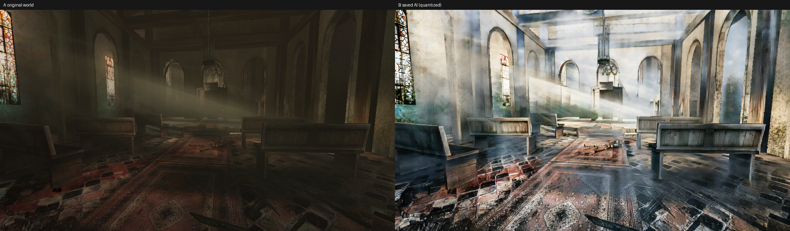

# RetroRecast

### クラシックPCゲームのニューラル描画 — AMD Radeonでの限定実証。

[English](README.md) · **日本語** · [简体中文](README.zh-CN.md)

[**実プレイ動画**](#gameplay) · [**ALPHAを取得**](#download) · [**SOURCE / BUILD**](BUILDING.ja.md) · [**既知の問題（英語）**](KNOWN_ISSUES.md)

昔のゲームを、元の遊びを残したまま新しい映像へ。**最初かつ唯一の実証対象はKilling Floor (2009)、KF1です。** 独自の取り組みはAMD実機でのゲーム統合：Direct3D 9 hook、同一フレームのプロセス間通信（IPC）、AI出力の合成、監督付き実験runtimeです。新しいAIモデルの開発や完成MODではありません。

## 実比較

**既存Windows実験で保存した実input / output。** 左：KF1のworld入力。右：**同一request**の量子化AI出力。**最終合成ゲーム画面同士の比較ではありません。** 明るさ・表面は大きく変わり、構造や材質の忠実な保持は保証できません。暗所改善や時間安定の証明でもありません。Killing Floor © Tripwire Interactiveほか。[画像の帰属・引用範囲](NOTICE.md#紹介画像)。

## 実プレイ動画 — 60秒PV

<!-- gameplay-video -->

https://github.com/user-attachments/assets/795368ae-fec0-4f0c-b331-bb530b4d1fe4

[**▶ 実プレイPVを視聴・取得（MP4、60秒、無音）**](https://github.com/zufall-upon/RetroRecast/releases/download/v0.1.0-alpha/RetroRecast-KF1-gameplay-preview.mp4)
<!-- /gameplay-video -->

実験的なAI描画を含む**実際のKF1プレイ録画**の編集版です。このページ用に架空のプレイ映像を生成したものではありません。映像の破綻と性能問題は残ります。元の2録画は視点・装備が異なり、各処理条件は未同定。**同条件Before/After、連続3分のプレイ、公開モデルの性能証明にはしません。** 動画のfps・解像度はAI推論性能ではありません。原PVの「私有プレビュー／開発中」という当時の題字は保持し、今回は本人の許可範囲で公開しています。[由来・credit・権利](NOTICE.md#gameplay-video)。

## 取得・導入

> [!WARNING]
> **過去の試験中にWindows本体の異常再起動が発生し、原因は未解決です。データ消失・ファイル破損の可能性があります。** 暗所・屋内の構造崩壊と性能低下も残ります。常用PCや重要データのある環境では実行しないでください。他GPUは未検証です。**この再梱包構成のWindows/GPU/KF1、ACL、異常停止後の復元は新実機で再検証していません。** 監督・復元手順は安全保証ではありません。**高リスクの研究用Experimental Alphaであり、安定版・完成MODではありません。**

| 入口 | 内容 |
|---|---|
| [**v0.1.0-alpha Experimental Alpha**](https://github.com/zufall-upon/RetroRecast/releases/tag/v0.1.0-alpha) | [**Windows実行ZIP**](https://github.com/zufall-upon/RetroRecast/releases/download/v0.1.0-alpha/RetroRecast-v0.1.0-alpha-windows.zip)、[SHA256SUMS](https://github.com/zufall-upon/RetroRecast/releases/download/v0.1.0-alpha/SHA256SUMS)、manifestと対応source |
| [**必要環境・導入・停止・無効化・復元（日本語）**](QUICKSTART.ja.md) | 警告から通読してください。オフライン・シングルプレイヤー、独立ゲームコピー、WestLondon・960×540の有限手動試験に限定。 |
| [**runtimeタグのsource**](https://github.com/zufall-upon/RetroRecast/tree/v0.1.0-alpha) · [build / CPU tests（日本語）](BUILDING.ja.md) | GitHub自動生成の「Source code」はsource-only。**実行ZIPとは別物**です。 |

標準Releases欄に表示するためGitHub上のPre-release指定は解除していますが、実験段階であり安定性・安全性の保証ではありません。ゲーム・モデル重み・Python/PyTorch/NumPy環境・FFmpeg・driverは**非同梱**で、各条件に従う正規取得が必要です。Windows既存実績は**RX 6950 XT / gfx1030、TheRock/ROCm PyTorch**の限定環境で、AMD全般の互換保証ではありません。CPU・DirectML等へ自動fallbackしません。

## 改善への参加

[開発状況・未解決課題](DEVELOPMENT_STATUS.md) · [Issues](https://github.com/zufall-upon/RetroRecast/issues) · [参加案内](CONTRIBUTING.md)（いずれも英語）。優先度は重要度であり着手順ではありません。最初はCPUの合成frame契約テストが比較的安全です。OS再起動の再現や私有資産を参加条件にしません。

## 何を再利用し、何を実証したか

| 層 | 範囲 |
|---|---|
| **再利用：[REGEN / CARLA2Flux](https://github.com/stefanos50/REGEN)** | Stefanos Pasiosによるgeneratorと未改変の学習済みFP32重み。元作者への帰属を保持し、新モデル・新学習は主張しません。 |
| **RetroRecast独自の統合** | KF1のD3D9描画取り出し、game/worker間の同frame IPC、出力合成、Windows process監督、公開source/build・復元入口。REGENより優れるという比較ではなく、本projectの実装範囲です。 |
| **既存の限定実証** | Linux/Wine＋Radeon RX 7900 XTXの描画・推論統合。Windows＋RX 6950 XTのGPU推論・同frame KF1表示・本人操作の記録。WindowsにはOS異常再起動と正常終了未達も含み、全Radeon GPUの認証ではありません。 |
| **公開時のオフライン確認** | hook/helper/smokeのcross-buildが既存binaryとbyte一致。CPU合成/IPC・導入復元境界を検査。公開用には私有画像の起動前oracleを明示 `synthetic + measure` の自己整合性確認に分離し、リンク拒否・復元receiptを追加。実機・画質・安全の合格ではありません。 |
| **未解決・未検証** | 暗所構造、画質、時間安定、性能目標、Windows再起動原因。他GPU・他ゲーム、再梱包後のWindows/GPU/game/ACL/復元経路。今回のページ整備では追加ゲーム/GPU/Windows試験・録画再試行はしていません。 |

[検証範囲](VALIDATION.md) · [既知の問題](KNOWN_ISSUES.md) · [配布/source対応](release-manifest.json) · [開発参加](CONTRIBUTING.md)（英語）。導入・ビルド手順は日英で提供し、その他の技術・権利文書には日本語のものもあります。

## 謝辞・権利

Killing Floor © Tripwire Interactiveほか。統合コードは**GPL-3.0-or-later、第三者部品は元license保持**。[NOTICE](NOTICE.md)・[LICENSE_SCOPE](LICENSE_SCOPE.md)を参照。コード、ゲーム映像・画像、モデル重み、教師/data、依存部品の権利を混同せず、コードlicenseで再許諾しません。runtimeにゲーム資産や重みは含めません。Tripwire・Valve・AMD・NVIDIA・REGEN作者の公認・サポート製品ではありません。
