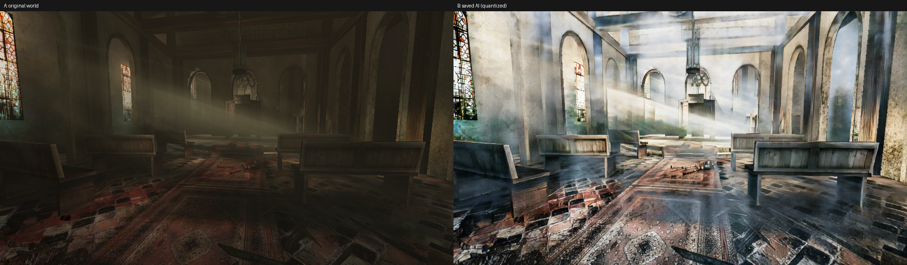

# RetroRecast

### 昔のゲームを、元の遊びを残したまま新しい映像へ。

Experimental neural rendering for classic PC games — **最初の実証対象は Killing Floor (2009)**。

**教会の実input / output比較。** 左：元ゲームのworld入力。右：同一requestに対応するCARLA2Fluxの量子化AI出力。**最終ゲーム画面同士のBefore/Afterではありません。** 新しく生成・撮影した画像ではなく、既存Windows実験の保存結果です。

右側では明るさ・表面の見え方が大幅に変化する一方、元の構造や材質が忠実に保たれる保証はありません。見栄えの変化と構造保持は別の課題です。この一枚は暗所改善や時間安定の証明ではありません。Killing Floor © Tripwire Interactiveほか。画像の引用・権利範囲は[NOTICE](NOTICE.md#紹介画像)を参照。

## KF1 Playable Experimental Alpha

[Pre-release / 実行パッケージ](https://github.com/zufall-upon/RetroRecast/releases/tag/v0.1.0-alpha) · [導入・停止・無効化・復元](QUICKSTART.md) · [Source / Build / CPU Tests](BUILDING.md) · [Known Issues](KNOWN_ISSUES.md)

> **重大な警告：Windows本体の異常再起動**
>
> 過去のWindows試験中に、原因未確定のOS全体の異常再起動が複数回発生しました。**データ消失・ファイル破損の可能性があります。** 暗所・屋内の構造崩壊、性能低下も未解決です。検証したGPU以外は未検証です。常用PCでは実行せず、重要データを置かない独立した実験用環境に限定してください。警告・監督・復元手順はOS障害を防ぐ保証ではありません。**安定版・完成MODではありません。**

このAlphaは、独立した正規KF1コピーへD3D9 hookを配置し、同一フレームのGPU推論出力を合成する研究用入口です。画像変換だけのデモではありません。ゲーム本体・モデル・Python環境は含まれず、[利用者自身による公式取得](QUICKSTART.md)が必要です。オフライン・シングルプレイヤー・WestLondon・960×540の有限手動試験を対象にし、通常の完成MODの使い勝手を約束しません。

### 実証・今回の確認・未達を分ける

| 区分 | 内容 |
|---|---|
| 既存実績 | Linux/Wine＋Radeonの描画統合、WindowsのGPU推論・同一frame IPC・KF1描画と本人操作の限定記録。Windows試験にはOS異常再起動と正常終了未達も含みます。 |
| 今回のオフライン確認 | hook・atomic helper・smokeのソースからのcross-buildが既存実使用binaryとbyte一致。CPUの合成画素・IPC・通常フレーム経路・衝突拒否・停止/復元境界を検査。 |
| 公開構成の変更 | 私有ゲーム画像を必要とした起動前oracleを、明示 `synthetic + measure` による自己整合性確認へ分離。導入のリンク拒否・復元receiptを追加。推論モデル・画素前後処理・実game側hook/chainは維持。 |
| 未検証・未達 | **この再梱包構成のWindows実機・GPU・ゲーム・ACL・異常停止後の復元は再検証していません。** 暗所、画質/性能目標、時間安定、OS再起動原因は未解決。他GPU・他ゲーム対応は未実証です。 |

CPU mockや配布hash一致は、新しい実機PASSや安全性の証明ではありません。Windows・追加ゲーム/GPU実験・録画の再試行は今回行っていません。[検証範囲](VALIDATION.md)と[配布対応表](release-manifest.json)に限定を残します。

## 何を再利用し、何を作ったか

[REGEN / CARLA2Flux](https://github.com/stefanos50/REGEN) の既存generator・未改変FP32モデルを利用しています。本プロジェクトの作業はKF1の描画取り出し、同一frame IPC、合成、Windows監督と公開用入口の統合です。新モデル・新学習の成果ではありません。既存技術への帰属とファイル別条件は[NOTICE](NOTICE.md)・[LICENSE_SCOPE](LICENSE_SCOPE.md)に記載しています。

## 試して、続きを作る

- **試す人**：[QUICKSTART](QUICKSTART.md)を最初から読み、Pre-releaseのruntime ZIPとSHA256SUMSを取得。ゲーム・重み・環境は自分で正規取得してください。
- **改良する人**：[BUILDING](BUILDING.md)のCPUテストはゲーム・重み・GPU不要。Release ZIPにも対応sourceとbuild入口を含めています。
- **参加する人**：[CONTRIBUTING](CONTRIBUTING.md)の少数課題から。暗所改善・他ゲーム対応・GPU最適化を達成済みと扱わず、観測条件を添えてください。

RetroRecastは広い研究の名前ですが、今回のAlphaの実証範囲はKF1だけです。Steam Workshop等への公開や汎用ゲーム対応はこのリリースに含めません。
