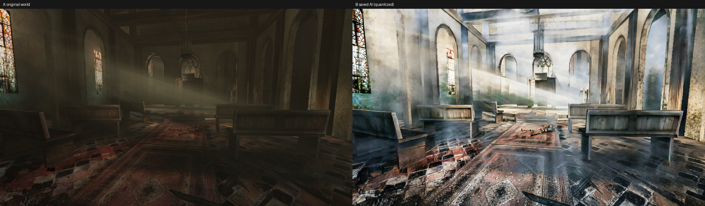

# RetroRecast

### 面向经典PC游戏的实验性神经渲染 — 已在AMD Radeon上进行有限验证。

[English](README.md) · [日本語](README.ja.md) · **简体中文**

[**实机游戏视频**](#gameplay) · [**获取ALPHA**](#download) · [**源码 / 构建**](BUILDING.md) · [**已知问题**](KNOWN_ISSUES.md)

RetroRecast探索在保留原有玩法的同时，为老游戏带来新的画面。**首个且唯一经过演示的目标是Killing Floor (2009)，简称KF1。** 本项目的贡献是在AMD硬件上完成实际游戏集成：Direct3D 9 hook、同帧进程间通信（IPC）、AI输出合成及受监督的实验运行入口。它不是新AI模型，也不是已完成的画质MOD。

## 实际输入与输出

**来自既有Windows实验的真实保存结果。** 左：KF1的world输入；右：**同一request**对应的量化AI输出。**这不是两张最终合成游戏画面的对比。** 亮度和表面变化明显，但无法保证结构和材质忠实保留。此静态图不能证明暗处问题已修复或时间稳定性已达成。Killing Floor © Tripwire Interactive及其他权利人。[图片来源及引用范围](NOTICE.md#紹介画像)。

## 游戏演示 — 60秒PV

<!-- gameplay-video -->

https://github.com/user-attachments/assets/795368ae-fec0-4f0c-b331-bb530b4d1fe4

[**▶ 观看 / 下载游戏PV（MP4，60秒，无声）**](https://github.com/zufall-upon/RetroRecast/releases/download/v0.1.0-alpha/RetroRecast-KF1-gameplay-preview.mp4)
<!-- /gameplay-video -->

这是包含实验性AI渲染画面的**真实KF1游戏录像**剪辑，而不是为本页面生成的虚构游戏视频。画面瑕疵和性能问题仍然存在。两段原录像的视角、装备不同，具体处理条件尚未确认，因此**不属于同条件前后对比、连续三分钟游戏或发布模型的性能测试**。视频的帧率、分辨率不代表AI推理性能。原PV中历史性的“私有预览／开发中”字幕予以保留，本次经所有者授权分享。[视频来源、署名及权利](NOTICE.md#gameplay-video)。

## 下载与尝试

> [!WARNING]
> **此前实验期间曾发生Windows系统异常重启，原因尚未解决，可能导致数据丢失或文件损坏。** 暗处、室内结构崩坏以及性能下降问题仍然存在。请勿在日常使用或存有重要数据的电脑上运行。其他GPU尚未验证。**本次重新打包配置尚未在Windows/GPU/KF1实机上重新验证，包括ACL及异常终止后的恢复。** 监督和恢复步骤不保证安全。**这是高风险研究用Pre-release，不是稳定版或完成的MOD。**

| 入口 | 内容 |
|---|---|
| [**v0.1.0-alpha Pre-release**](https://github.com/zufall-upon/RetroRecast/releases/tag/v0.1.0-alpha) | [**Windows可执行ZIP**](https://github.com/zufall-upon/RetroRecast/releases/download/v0.1.0-alpha/RetroRecast-v0.1.0-alpha-windows.zip)、[SHA256SUMS](https://github.com/zufall-upon/RetroRecast/releases/download/v0.1.0-alpha/SHA256SUMS)、manifest及对应源码 |
| [**环境要求 · 安装 · 停止 · 禁用 · 恢复（英语）**](QUICKSTART.md) · [日语](QUICKSTART.ja.md) | 请先阅读风险。仅面向离线单人、独立游戏副本、WestLondon、960×540的有限手动实验。 |
| [**runtime标签对应源码**](https://github.com/zufall-upon/RetroRecast/tree/v0.1.0-alpha) · [构建 / CPU测试（英语）](BUILDING.md) · [日语](BUILDING.ja.md) | GitHub自动生成的“Source code”归档只有源码，**不等同于可执行ZIP**。 |

**不包含**游戏、模型权重、Python/PyTorch/NumPy环境、FFmpeg或驱动，需按各自条件合法取得。既有Windows记录使用**RX 6950 XT / gfx1030、TheRock/ROCm PyTorch**，不代表对所有AMD硬件的兼容承诺。不提供CPU、DirectML等自动fallback。

## 参与改进

[开发状态与未解决问题](DEVELOPMENT_STATUS.md) · [Issues](https://github.com/zufall-upon/RetroRecast/issues) · [参与指南](CONTRIBUTING.md)（均为英语）。优先级表示重要性而非入手顺序；CPU合成帧契约测试是更安全的首次贡献。不要求重现系统重启或提供私有资源。

## 复用了什么，验证了什么？

| 层次 | 范围 |
|---|---|
| **复用：[REGEN / CARLA2Flux](https://github.com/stefanos50/REGEN)** | Stefanos Pasios的generator及未修改的预训练FP32权重。保留上游署名，不声称开发了新模型或进行新训练。 |
| **RetroRecast的集成实现** | KF1 D3D9帧提取、game与worker的同帧IPC、输出合成、Windows进程监督、公开源码/构建及恢复入口。这是本项目的贡献范围，不是优于REGEN的比较结论。 |
| **已有的有限验证** | Linux/Wine＋Radeon RX 7900 XTX的渲染和推理集成；Windows＋RX 6950 XT的GPU推理、同帧KF1显示和所有者操作记录。Windows记录也包含系统异常重启和未能正常退出，不是对所有Radeon GPU的认证。 |
| **发布时的离线检查** | 交叉构建的hook/helper/smoke与原二进制逐字节一致；检查CPU合成/IPC及安装恢复边界。公开版本将私有图片启动oracle改为显式 `synthetic + measure` 自洽检查，并增加链接拒绝和恢复receipt。这些不证明实机、画质或安全合格。 |
| **未解决 / 未验证** | 暗处结构、画质、时间稳定性、性能目标、Windows重启原因；其他GPU/游戏；重新打包后的Windows/GPU/game/ACL/恢复路径。本次页面整理未进行额外游戏/GPU/Windows测试或重新录制。 |

[验证范围](VALIDATION.md) · [已知问题](KNOWN_ISSUES.md) · [发布/源码对应](release-manifest.json) · [参与开发](CONTRIBUTING.md)（英语）。安装与构建指南提供英语和日语；其他部分技术及许可证文档仍为日语。

## 致谢与权利

Killing Floor © Tripwire Interactive及其他权利人。集成代码使用**GPL-3.0-or-later，第三方组件保留原许可证**；参见[NOTICE](NOTICE.md)和[LICENSE_SCOPE](LICENSE_SCOPE.md)。代码、游戏视频/图片、模型权重、教师/data及依赖项的权利各不相同，代码许可证不会重新授权这些内容。runtime不分发游戏资产或权重。本项目并非Tripwire、Valve、AMD、NVIDIA或REGEN作者认可或支持的产品。
